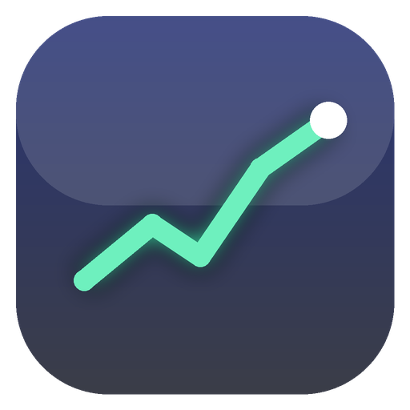

# Glass Ticker

A frameless, acrylic-glass desktop market ticker for Windows. It lives in a
small always-on-top window instead of a browser tab, so prices stay visible
while you work.



## Install

The app is a single portable executable - no installer, no runtime to set up.

**winget** (once the manifest is merged upstream)

```powershell
winget install ShounakJoshi.GlassTicker
```

**Scoop**

```powershell
scoop bucket add glass-ticker https://github.com/shounakjoshi88-a11y/scoop-bucket
scoop install glass-ticker
```

**npm** - the wrapper downloads the executable and gives you `glassticker`

```bash
npm install -g glass-ticker
glassticker
```

**pip / PyPI** - same idea, gives you `glass-ticker`

```bash
pip install glass-ticker
glass-ticker
```

**Maven** - a launcher jar for JVM projects

```bash
mvn dependency:get -Dartifact=io.github.shounakjoshi88:glass-ticker-launcher:2.0.0
java -jar ~/.m2/repository/io/github/shounakjoshi88/glass-ticker-launcher/2.0.0/glass-ticker-launcher-2.0.0.jar
```

**Direct download**

Grab `GlassTicker.exe` from the
[releases page](https://github.com/shounakjoshi88-a11y/glass-ticker/releases).
Each release also publishes `release.json` with the binary's SHA-256 and
`GlassTicker.exe.sha256` for command line checks.

**GitHub Packages** - every tag also publishes the npm and Maven wrappers to
this repository's own package registry:

```bash
npm install @shounakjoshi88-a11y/glass-ticker --registry=https://npm.pkg.github.com
```

```xml
<dependency>
  <groupId>com.github.shounakjoshi88</groupId>
  <artifactId>glass-ticker-launcher</artifactId>
  <version>2.3.0</version>
</dependency>
```

All the language wrappers fetch `release.json` first and verify the download
against that hash - a mismatched file is deleted instead of executed.

## Platforms

| Platform | Build | Install |
| --- | --- | --- |
| **Windows** | portable `.exe` | download it, or `winget install ShounakJoshi.GlassTicker`, or `scoop install glass-ticker` |
| **macOS** | `.dmg` and `.zip` | download and drag to Applications |
| **Linux** | `.AppImage` and `.deb` | `chmod +x *.AppImage && ./GlassTicker*.AppImage`, or `sudo dpkg -i *.deb` |
| **iOS / Android** | the web component | open the component in Safari/Chrome - see below |

The window chrome adapts to the platform: the Windows acrylic backdrop on
Windows 11, the macOS vibrancy material on macOS, and a transparent window
where the CSS glass does the work on Linux.

iOS and Android cannot run an Electron app, but the **component** works
there unchanged - it is plain HTML - so point a `WKWebView` (or a Capacitor
or Cordova shell) at the data API and drop the `<glass-ticker>` tag in.

## Use it as a plugin in your own app

The ticker UI is also a **standalone web component**, so you can drop it into
any application - not just use the desktop app.

```html
<script type="module" src="https://unpkg.com/@glass-ticker/core/dist/glass-ticker.js"></script>
<glass-ticker symbols="NVDA,AAPL,TSLA" symbol="NVDA" endpoint="/api"></glass-ticker>
```

| Stack | Package | Install |
| --- | --- | --- |
| Any web app | `@glass-ticker/core` | `npm i @glass-ticker/core` |
| React | `@glass-ticker/react` | `npm i @glass-ticker/react` |
| Vue | `@glass-ticker/vue` | `npm i @glass-ticker/vue` |
| Node backend | `@glass-ticker/server` | `npm i @glass-ticker/server` |
| Python | `glass-ticker` | `pip install glass-ticker` |
| Java / Spring | `com.github.shounakjoshi88:glass-ticker-launcher` | Maven Central |

A browser cannot call Yahoo directly (CORS), so the component reads from a
tiny data API. Every binding ships the same three endpoints:

```
GET /api/quotes?symbols=NVDA,AAPL
GET /api/chart?symbol=NVDA&range=1D
GET /api/search?q=tesla
```

Start it with `npx glass-ticker-server`, `glass-ticker serve`, or
`java -jar glass-ticker-launcher.jar` - or point `endpoint` at your own
backend. Full usage for every stack is in
[`packages/core/README.md`](packages/core/README.md), and a live demo is in
[`demo/`](demo/).

## What it does

- **Carbon theme** - flat graphite surfaces with a single accent colour
- **Dynamic island** - a pill that docks at the top of the screen and expands
  on hover, carrying live quotes and alert actions. Right click it to send it
  behind the other windows, bring it back in front, or park it in any corner.
  Drag it to move it anywhere, and `Ctrl+Shift+I` toggles it to the front even
  when it is buried behind another app
- **Pinnable desktop widget** - drag the chart out of the window and it pins
  as a small always-on-top widget anywhere on the desktop, still receiving
  live data
- **Company logos, discovered automatically** - provider logo, then the issuer
  website favicon, then a monogram fallback. Cached locally for a week so the
  list does not re-fetch on every refresh
- **Watchlist tabs** with live sparklines across NSE/BSE indices, Indian and US
  equities, and crypto (`^NSEI`, `RELIANCE.NS`, `AAPL`, `BTC-USD`, ...)
- **Interactive chart** for the selected symbol with range switching, area or
  candle style, an optional SMA overlay and RSI
- **Alerts on price targets or percentage moves**, with native Windows
  notifications
- **Portfolio positions** - quantity and average cost per symbol, with live
  day change and P&L, plus a **currency converter** for the totals
- **Mini ticker-strip mode** for a single line of scrolling quotes
- **Light and dark themes**, drag-to-reorder rows, and sorting by change
- **Window control** - always on top, opacity slider, start at login, system
  tray, maximize, and the `Ctrl+Shift+G` global hotkey
- Everything is stored locally (`localStorage` plus a small window-bounds file)

## Data source

Quotes and charts come from Yahoo Finance's public endpoints. The renderer is
locked down by a strict Content Security Policy and can only reach the
main process through a preload bridge; the main process allowlists the Yahoo
hosts before fetching.

Prices are near-real-time but Yahoo can delay some feeds by up to 15 minutes,
so treat the number as an indication rather than a tick.

## Repository layout

```
index.html, main.js, preload.js     the app
icon.png, build/icon.ico            icons
pom.xml, src/                       Maven launcher + embeddable data server
packaging/winget/                   winget-pkgs manifest (submitted upstream)
packaging/scoop/                    scoop bucket (published as its own repo)
packages/core/                      the embeddable web component
packages/react/                     React wrapper
packages/vue/                       Vue wrapper
packages/server/                    reference data API for Node
packages/npm/glass-ticker/          npm wrapper for the desktop app
packages/python/                    PyPI wrapper + embeddable data server
tools/check-exe-icon.ps1            verifies the icon is embedded in a built exe
demo/                               live demo for the component
```

## Build from source

```bash
npm install
npm start          # run the app
npm run dist       # build dist/GlassTicker.exe (portable, x64)
```

The Windows build needs to run on Windows. `electron-builder` uses `rcedit`
to embed `build/icon.ico` into the executable, and that tool is only
available in the Windows build of `electron-builder`. A build produced on
Linux still works, but Windows Explorer shows a generic icon for it.

## Releases

`.github/workflows/build.yml` builds the portable executable on
`windows-latest` for every push to `main` and uploads it as a workflow
artifact. Push a `v*` tag and the same executable is attached to the GitHub
release automatically:

```bash
git tag v2.0.0
git push origin v2.0.0
```

The executable is **not code-signed**, so Windows SmartScreen shows a
warning the first time you run it. Choose *More info* -> *Run anyway*.

## Known limits

- The desktop app is Electron, so there is no native iOS or Android build -
  use the web component there
- The executable is not code-signed, so macOS Gatekeeper and Windows
  SmartScreen both warn on first run
- Quotes come from Yahoo's public feed and can be delayed up to 15 minutes on
  some exchanges
- Company logos come from a third-party favicon service, so a symbol with no
  known issuer falls back to a monogram
- Start at login is wired up on Windows and macOS only

## License

MIT
